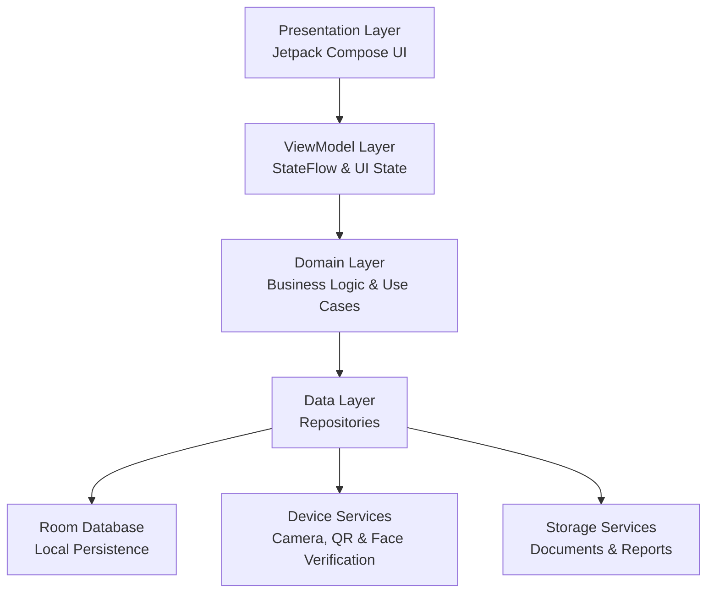

# 🎓 EduNexus
### Smart Student & Classroom Management System

<p align="center">
  <strong>A smarter way to manage classrooms, simplify academic workflows, and connect students, teachers, and administrators.</strong>
</p>

<p align="center">
  
  
  
  
</p>

---

## 📌 Overview

**EduNexus** is a modern Android-based classroom management application designed to streamline academic administration and improve the everyday classroom experience.

The platform brings students, teachers, and administrators together through a unified application, providing a structured environment for attendance management, academic activities, classroom coordination, and student performance tracking.

Built with **Kotlin and Jetpack Compose**, EduNexus follows an offline-first approach, prioritizing local data management, accessibility, performance, and a clean user experience.

The goal is simple: make classroom management smarter, faster, and more efficient.

## ✨ Key Features

EduNexus is designed around three primary user roles.

### 🎓 Student Module
- QR-based student identification.
- Face verification for student authentication.
- Personalized student dashboard.
- Attendance tracking and history.
- Class schedules and timetable.
- Assignments and academic tasks.
- Notes and learning materials.
- Quizzes and assessment results.
- Academic performance tracking.
- EduBot educational assistance.
- Digital student identity card.

### 👨‍🏫 Teacher Module
- Dedicated teacher dashboard.
- Classroom and subject management.
- Attendance management through manual, QR, and face-based workflows.
- Assignment creation and management.
- Quiz creation and evaluation.
- Student performance monitoring.
- Class analytics and attendance insights.
- Notices and classroom announcements.
- Study material management.

### 🛡️ Administrator Module
- Centralized administration dashboard.
- Student and teacher management.
- Department, semester, and subject management.
- Class and enrollment management.
- Timetable management.
- Notice and announcement management.
- Attendance and academic reports.
- CSV/PDF report generation.
- System-level data management.

> **Development note:** The feature list describes the project's intended scope. Individual features may be under development and should be considered complete only after implementation and testing.

## 🚀 What Makes EduNexus Different?

| Capability | Approach |
|---|---|
| Architecture | Offline-first Android application |
| Data Management | Local database using Room |
| Authentication | Role-based access |
| Student Identification | QR-based identification with face verification |
| Attendance | Manual, QR, and face-based workflows |
| User Interface | Modern native Jetpack Compose UI |
| Academic Management | Integrated classroom and student workflows |
| Educational Assistance | EduBot with local educational knowledge |

## 🛠️ Technology Stack

The project uses modern Android development technologies.

| Technology | Purpose |
|---|---|
| Kotlin | Primary programming language |
| Jetpack Compose | Native declarative UI |
| Material 3 | UI components and design system |
| Room Database | Local persistence |
| Kotlin Coroutines | Asynchronous operations |
| StateFlow / Flow | Reactive state management |
| ViewModel | UI state and lifecycle-aware logic |
| Navigation Compose | Application navigation |
| Hilt | Dependency injection |
| CameraX | Camera integration |
| ML Kit | On-device face and barcode detection |
| ONNX Runtime Mobile | Planned on-device face embedding inference |
| Storage Access Framework | Local document selection |

## 🏗️ Architecture

EduNexus follows a layered architecture to keep the application modular, maintainable, and scalable.



### Architectural Principles

- **Separation of Concerns:** UI, business logic, and data management remain independent.
- **Offline-First Design:** Core application workflows are designed to work without mandatory internet access.
- **Modularity:** Features are organized to support maintainability and future expansion.
- **Reactive UI:** StateFlow and Kotlin Flow support responsive UI updates.
- **Local Data Ownership:** Academic data is intended to remain locally managed by the application.

## 🎨 User Experience

EduNexus aims to provide a polished, modern, and intuitive mobile experience.

Design priorities include:

- Dark-first visual design.
- Consistent typography and spacing.
- Clear information hierarchy.
- Smooth navigation and transitions.
- Subtle animations and micro-interactions.
- Responsive layouts for different screen sizes.
- Accessible loading, empty, success, and error states.

## 📱 Platform Requirements

| Requirement | Specification |
|---|---|
| Platform | Android |
| Minimum Android Version | Android 10 |
| Minimum SDK | API 29 |
| Development Environment | Android Studio |
| Language | Kotlin |
| UI Framework | Jetpack Compose |
| Database | Room / SQLite |

## ⚙️ Getting Started

### Prerequisites

Before running EduNexus, make sure you have:

- [Android Studio](https://developer.android.com/studio) installed.
- Android SDK configured.
- Kotlin support enabled.
- An Android device or emulator running Android 10 or later.

### Installation

**1. Clone the repository**

```bash
git clone https://github.com/YOUR-USERNAME/YOUR-REPOSITORY.git
```

**2. Open the project**

Open Android Studio and select:

`File → Open → Select the EduNexus project folder`

**3. Sync Gradle**

Allow Android Studio to download the required dependencies and complete Gradle synchronization.

**4. Run the application**

Connect an Android device with USB debugging enabled or start an emulator.

Click **Run ▶** in Android Studio.

> Replace the repository URL above with your actual GitHub repository URL.

## 🔐 Privacy & Data Management

EduNexus is designed with local-first data management in mind.

- Core academic workflows are intended to function without a mandatory cloud backend.
- Room provides local structured data persistence.
- Camera-based features are designed for on-device processing.
- Sensitive authentication and student information require appropriate protection.
- Optional online educational resources may require an internet connection.

## 🗺️ Project Roadmap

The following areas represent the project's development goals.

- [ ] Complete student, teacher, and administrator workflows.
- [ ] Complete QR-based student identification.
- [ ] Integrate and validate on-device face recognition.
- [ ] Implement unified attendance management.
- [ ] Complete assignment and quiz workflows.
- [ ] Implement academic analytics and reporting.
- [ ] Complete EduBot educational assistance.
- [ ] Improve accessibility and UI responsiveness.
- [ ] Perform comprehensive device and workflow testing.

## 🔮 Future Scope

Potential future enhancements include:

- AI-powered educational assistance.
- Intelligent learning recommendations.
- Improved face recognition and verification.
- Optional cloud synchronization.
- Multi-institution support.
- Advanced academic analytics.
- Real-time classroom communication.
- Multilingual support.

## 🎯 Project Objectives

1. Simplify classroom and academic management.
2. Improve attendance tracking and student identification.
3. Centralize academic activities in one application.
4. Reduce repetitive administrative work.
5. Provide students with easier access to academic information.
6. Build an efficient, maintainable, and scalable Android solution.

## 👨‍💻 Development

**Project:** EduNexus  
**Project Type:** Android Application / Academic Project  
**Domain:** Education Technology  
**Department:** Computer Science & Design  
**Institution:** Madhav Institute of Technology & Science (MITS), Gwalior

## 📄 License

The licensing terms for this project have not yet been specified. Please contact the repository owner before redistributing or reusing the source code.

---

<p align="center">
  <strong>EduNexus — Connecting Classrooms. Empowering Education.</strong>
  <br/>
  <sub>Designed to make academic management smarter and simpler.</sub>
</p>
